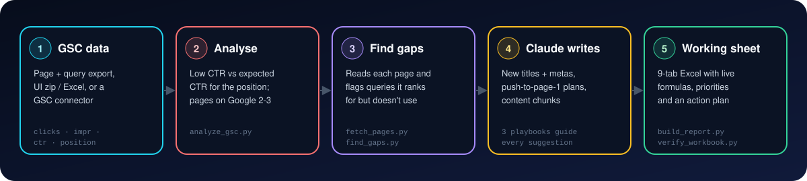
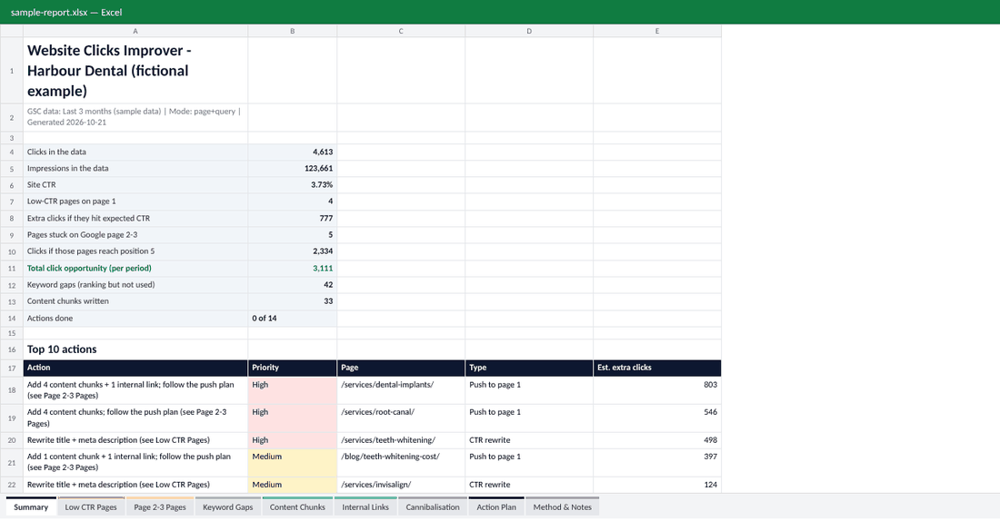

<div align="center">


<br/>

[](CHANGELOG.md)
[](LICENSE)
[](#-see-the-working-sheet)
[](references/getting-gsc-data.md)

[](#-quick-start)
[](requirements.txt)
[](CONTRIBUTING.md)

### Find the pages that are leaking clicks, and get the exact fixes back as an Excel working sheet.

[**🚀 Quick start**](#-quick-start) · [**📥 What data to give it**](references/getting-gsc-data.md) · [**📊 Sample report**](examples/sample-report.xlsx) · [**🧠 SKILL.md**](SKILL.md)

</div>

---

## ✨ What it does

Upload a Search Console export. The skill finds three kinds of lost clicks and writes the fixes for each.

<table>
<tr>
<td width="33%" valign="top">

### 📉 Low-CTR pages
Pages on Google **page 1** whose CTR is far below what their position should earn. You get a diagnosis tied to the evidence, **2 new titles**, **2 new meta descriptions** and other snippet fixes.

</td>
<td width="33%" valign="top">

### 🪜 Page 2-3 pages
Pages at **position 11-30**, close enough to push onto page 1. You get a **step-by-step push plan**: which sections to add, which pages should link to it, and what to fix first.

</td>
<td width="33%" valign="top">

### 🧩 Missing keywords
Queries a page **already ranks for** but never (or only partly) uses in its copy. You get **ready-to-paste content chunks** (FAQs, pricing sections, comparison tables, new H2s) and where on the page each one goes.

</td>
</tr>
</table>

Every number comes from your GSC data, and every suggestion is written for a specific page.

---

## ⚙️ How it works

<div align="center">

</div>

| Step | What happens | Script |
|:-:|---|---|
| 1 | Reads any GSC export: page+query rows, the web-UI `.zip`/`.xlsx`, or separate Pages/Queries files | `analyze_gsc.py` |
| 2 | Compares each page's CTR with the **expected CTR for its position**; lists page 2-3 pages; spots cannibalisation | `analyze_gsc.py` |
| 3 | Reads each flagged page (title, meta, headings, body) and checks every ranking query against it | `fetch_pages.py` · `find_gaps.py` |
| 4 | Claude writes titles, metas, push plans and content chunks, guided by three playbooks | [`references/`](references) |
| 5 | Builds the Excel working sheet and checks it: zero formula errors, titles ≤ 60, metas 70-160 chars | `build_report.py` · `verify_workbook.py` |

---

## 📊 See the working sheet

<div align="center">

<br/><sub><i>Built from the fictional sample data in <a href="examples">examples/</a>. Download <a href="examples/sample-report.xlsx">sample-report.xlsx</a> to click around.</i></sub>
</div>

<br/>

<details>
<summary><b>📑 All 9 tabs (click to expand)</b></summary>

<br/>

| # | Tab | What's in it |
|:-:|-----|--------------|
| 1 | 🏠 **Summary** | Clicks, impressions, CTR, total click opportunity, top 10 actions, how to use the sheet |
| 2 | 📉 **Low CTR Pages** | CTR vs expected CTR, extra clicks available, top queries, current title/meta vs 2 suggested titles and 2 metas with live `LEN()` counters, diagnosis |
| 3 | 🪜 **Page 2-3 Pages** | SERP page, clicks if it reached position 5, keywords sitting on page 2-3, push-to-page-1 plan, internal links to add |
| 4 | 🔎 **Keyword Gaps** | Every ranking query that isn't used properly: status, intent, in title / H1 / H2-H3 / body, missing words |
| 5 | 🧩 **Content Chunks** | Ready-to-paste text per keyword cluster: chunk type, placement, heading, content, word count, facts to check |
| 6 | 🔗 **Internal Links** | Stronger pages that should link to each target, with anchor text |
| 7 | ⚔️ **Cannibalisation** | Queries where two of your pages split impressions (only when found) |
| 8 | ✅ **Action Plan** | Every action, prioritised, with estimated clicks, owner, status dropdown and date done |
| 9 | 📐 **Method & Notes** | Date range, thresholds, the CTR curve used, caveats, data warnings |

Green cells are suggestions to review. Amber cells are yours to fill in.

</details>

---

## 🚀 Quick start

### In Claude (claude.ai)
1. Download [`website-clicks-improver.skill`](website-clicks-improver.skill).
2. Upload it in Claude's **Skills** settings (code execution needs to be on).
3. Start a chat, attach your GSC export and say:

```text
Find my low-CTR pages, pages on page 2-3 and keywords we rank for but don't use.
Site: https://example.com · Brand: Example Co · Write in Australian English.
```

### In Claude Code
```bash
git clone https://github.com/akifseospecialist-digitalmarketer/website-clicks-improver.git \
  ~/.claude/skills/website-clicks-improver
pip install -r ~/.claude/skills/website-clicks-improver/requirements.txt
```
Then ask Claude Code to "run website-clicks-improver on `gsc-export.zip`".

### Without Claude (scripts only)
Steps 1-3 and 5 run anywhere. Step 4, writing the suggestions, is the part an AI (or you) does.
```bash
pip install -r requirements.txt
python3 scripts/analyze_gsc.py examples/sample-gsc-page-query.csv examples/sample-gsc-pages.csv \
  --brand "harbour dental" --date-range "Last 3 months" -o work/analysis.json
python3 scripts/fetch_pages.py work/analysis.json -o work/pages.json \
  --content-json examples/sample-page-content.json --no-fetch
python3 scripts/find_gaps.py work/analysis.json work/pages.json -o work/gaps.json
python3 scripts/build_report.py --analysis work/analysis.json --pages work/pages.json --gaps work/gaps.json \
  --suggestions examples/sample-suggestions.json -o outputs/report.xlsx --md outputs/summary.md
python3 scripts/verify_workbook.py outputs/report.xlsx
```

> [!TIP]
> **Give it page + query data** (one row per page × query). That's what unlocks the keyword-gap and content-chunk part.
> Search Analytics for Sheets, Looker Studio, the GSC API, or per-page filtered exports from the GSC interface all work.
> See [`references/getting-gsc-data.md`](references/getting-gsc-data.md).

---

## 🔎 How pages get flagged

| List | Rule (defaults, all adjustable) | Estimate shown |
|---|---|---|
| **Low CTR** | Avg position < 11 · ≥ 100 impressions · CTR < 70% of the expected CTR for that position | Extra clicks = impressions × expected CTR − clicks |
| **Page 2-3** | Avg position 11-30.9 · ≥ 50 impressions | Clicks at position 5 = impressions × CTR@5 − clicks (conservative) |
| **Keyword gap** | Non-brand query with ≥ 10 impressions whose phrase isn't in the copy, or is only in body text | Impressions the query already gets |

<details>
<summary><b>Expected CTR curve (click to expand)</b></summary>

<br/>

A deliberately conservative organic CTR curve, blended from public CTR studies and adjusted down for the AI Overviews era:

| Position | 1 | 2 | 3 | 4 | 5 | 6 | 7 | 8 | 9 | 10 | 11-15 | 20 | 30 |
|---|---|---|---|---|---|---|---|---|---|---|---|---|---|
| Expected CTR | 25% | 15% | 10% | 7% | 5.5% | 4% | 3.2% | 2.6% | 2.2% | 1.9% | 1.2-0.8% | 0.6% | 0.3% |

Use `--benchmark site` to compare pages with **your own site's** CTR by position instead (best for 100+ page sites),
or pass your own curve with `--ctr-curve curve.json`.

</details>

### Keyword status

| Status | Meaning | Typical fix |
|---|---|---|
| **Missing** | Most of the query's words aren't on the page | New section / FAQ / pricing block |
| **Partial** | Some words are missing (listed) | Add a section or paragraph covering them |
| **Scattered terms** | Every word is there, never as the phrase people search | Sentence edit |
| **Not in headings** | Phrase is only in body copy (flagged for the page's top queries) | Heading edit |

Gap queries are grouped by **intent** so one chunk covers several of them: price searches → one pricing section,
questions → one FAQ block, comparisons → one table, "near me" → local signals (never the literal words).

---

## 🛡️ Rules baked in

- 📏 **Titles ≤ 60 characters, metas 140-155**, checked by `verify_workbook.py` before delivery
- 🚫 **No invented facts**: prices, stats and guarantees become `[placeholders]` listed under "Check before publishing"
- 🧂 **No keyword stuffing**: each keyword once, in a natural sentence, with fixed grammar
- 📍 **Never writes "near me" into copy**: uses real suburbs, address and schema instead
- ⚔️ **Respects page ownership**: if another page owns a query, it writes a teaser + link, not a competing section
- 🗣️ **Matches the site's voice** and language variant (e.g. Australian English)
- 🧮 **Formulas, not hard-coded totals**: CTRs, char counts and click estimates update as you edit

---

## 🎛️ Customising

| Want to... | Do this |
|---|---|
| Analyse a small site | `--min-impr 30 --min-impr-p23 20 --min-pair-impr 5` |
| Be stricter about "low" CTR | `--ctr-threshold 0.5` (flag below 50% of expected) |
| Use your own CTR benchmark | `--benchmark site` or `--ctr-curve my-curve.json` |
| Exclude brand searches | `--brand "acme,acme plumbing,acmeplumbing"` |
| Look at more pages | `--top 50` (pages per list that get fetched, gap-checked and put in the workbook) |

---

## 📁 Repo structure

```
.
├── SKILL.md                      ← the skill: workflow Claude follows
├── website-clicks-improver.skill ← installable package (SKILL.md + scripts + references)
├── scripts/
│   ├── analyze_gsc.py            ← step 1-2: low CTR, page 2-3, page→query map, cannibalisation
│   ├── fetch_pages.py            ← step 2: title, meta, headings, body of each focus page
│   ├── find_gaps.py              ← step 3: keyword gaps, chunk clusters, snippet checks, link sources
│   ├── build_report.py           ← step 5: the 9-tab Excel working sheet
│   └── verify_workbook.py        ← step 6: formula errors + title/meta length checks
├── references/
│   ├── ctr-playbook.md           ← diagnosing low CTR + title/meta formulas by intent
│   ├── page-2-3-playbook.md      ← what moves a page from 11-30 onto page 1
│   ├── content-chunk-guide.md    ← chunk templates, placement, anti-stuffing rules
│   └── getting-gsc-data.md       ← how to export page + query data
├── examples/                     ← fictional dental clinic: inputs, suggestions, finished report
├── assets/                       ← banner, diagram, workbook preview
├── requirements.txt
├── CHANGELOG.md · CONTRIBUTING.md · LICENSE
└── .gitignore                    ← keeps client exports and reports out of the repo
```

---

## 🧰 Requirements

| Need | Notes |
|---|---|
| Google Search Console data | Page + query rows are best. Any GSC export works for the low-CTR and page 2-3 parts |
| Python 3.9+ | `pandas`, `openpyxl`, `requests`, `beautifulsoup4` (see `requirements.txt`) |
| Page access | The script fetches pages itself. In sandboxes that block it, Claude uses its web-fetch tool or asks you to paste the copy |
| Optional | A GSC connector/MCP (pulls data directly), web search (checks live SERPs and competitors), LibreOffice (formula check) |

---

## 📄 License

MIT. See [LICENSE](LICENSE). The sample data in `examples/` is fictional.

## 👋 About

Created by **Akif Qureshi | SEO Specialist & Digital Marketer**
🌐 [algoblueprints.com](https://algoblueprints.com)

More skills: [SEO · AEO · GEO Audit & Working Sheet](https://github.com/akifseospecialist-digitalmarketer/seo-aeo-geo-audit-and-working-sheet) · [GSC Opportunity Finder](https://github.com/akifseospecialist-digitalmarketer/claude-ai-gsc-opportunity-finder) · [AI Prompt Research](https://github.com/akifseospecialist-digitalmarketer/claude-ai-prompt-research-skill) · [SEO Master](https://github.com/akifseospecialist-digitalmarketer/seo-master-skill)
